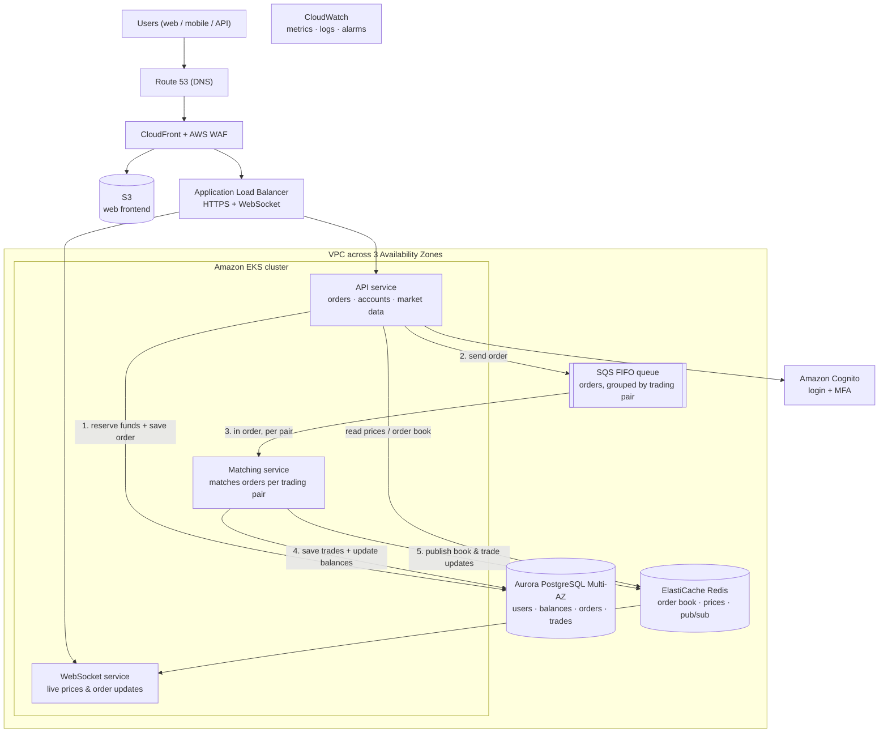

# Problem 1 — Building Castle In The Cloud

A highly available, scalable and cost-effective **spot-trading platform** (Binance-like) on AWS.

**Targets:** 500 requests/second, p99 response time < 100 ms.

## 1. Scope and assumptions

I chose a small set of features that still shows the key infrastructure concerns: ordering, consistency, real-time updates and failure handling.

| In scope | Out of scope |
|---|---|
| Sign-up / login | Crypto deposits & withdrawals (wallet custody) |
| Place / cancel limit and market orders | Futures, margin, fiat payments |
| Order matching per trading pair (e.g. BTC/USDT) | KYC, admin back-office |
| Account balances | |
| Market data: order book, recent trades, prices (REST + WebSocket) | |

**Assumptions**
- 500 RPS is the total HTTP API load. Roughly 60% is market-data reads, 30% order placement/cancellation and 10% account queries.
- p99 < 100 ms is measured at the server (load balancer in → response out). Internet latency to the user is outside our control.
- One AWS region, Singapore (`ap-southeast-1`), with 3 Availability Zones (AZs).
- **Balances must never be wrong.** If something fails, the system should reject new orders (the client can retry) rather than risk an incorrect balance.

## 2. Architecture overview

### How an order flows

1. The user sends an order. The **API service** checks the login token and request limits.
2. In one database transaction, it **reserves the funds** (balance must be enough) and saves the order with status `NEW`. A unique client order ID prevents duplicates if the user retries.
3. It sends the order to the **SQS FIFO queue**. The message group is the trading pair, so orders for BTC/USDT are always processed in the order they arrived.
4. The API returns `accepted` to the user. The work so far is a DB transaction plus a queue send, roughly 20–40 ms.
5. The **Matching service** takes orders from the queue one by one per pair and matches them against the in-memory order book. It saves the trades and updated balances to Aurora in one transaction.
6. It publishes order-book and trade updates to **Redis**. The **WebSocket service** pushes them to connected users, including "your order was filled".

## 3. Why each service, and alternatives considered

| Need | Choice | Why | Alternatives considered |
|---|---|---|---|
| DNS | Route 53 | Health checks and failover | — |
| Frontend + edge | CloudFront + S3 | Fast global delivery of the web app. Short caching (1 s) of public market data absorbs traffic spikes | Serving the frontend from the cluster (more load, higher cost) |
| Web protection | AWS WAF | Blocks common attacks and bots, rate-limits abusive IPs | Third-party CDN/WAF |
| Load balancer | ALB | Supports HTTPS and WebSocket, spreads traffic across AZs, low cost at 500 RPS | API Gateway: adds latency and per-request cost, and limits WebSocket connection duration |
| Compute | **Amazon EKS** | One platform for all services, auto-scaling (HPA + Karpenter), rolling deployments, and a skill set the team already has | **ECS Fargate**: simpler and also a good fit. EKS chosen for flexibility and team familiarity. **Lambda**: cold starts are a poor fit for steady, latency-sensitive traffic |
| Order queue | **SQS FIFO** | Fully managed. Keeps **strict order per trading pair** (message group). High-throughput mode handles far more than 500 RPS. No servers to operate | **Kafka (MSK)**: more powerful (replay, higher throughput) but more to operate. Planned for when we outgrow SQS (see §5) |
| Database | **Aurora PostgreSQL** (1 writer + 1 reader, Multi-AZ) | ACID transactions keep balances correct. Automatic failover (usually < 30 s). Storage replicated across 3 AZs | DynamoDB: scales well, but multi-row transactions for balances are harder. RDS PostgreSQL: cheaper, but slower failover |
| Cache / real-time | **ElastiCache Redis** (Multi-AZ) | Sub-millisecond reads for prices and order book; pub/sub to push updates to WebSocket pods; rate-limit counters | MemoryDB: durable but unnecessary, since cache data can be rebuilt |
| Login | Amazon Cognito | Managed sign-up/login, MFA, password security | Building our own auth (risky) |
| Monitoring | CloudWatch (+ Container Insights) | Metrics, logs, alarms and dashboards in one place | Prometheus/Grafana, Datadog |

**Network layout:**
- **Public subnets:** only the ALB and NAT gateways.
- **Private subnets:** EKS nodes, Aurora, Redis. No direct internet access.
- **VPC endpoints:** for S3, SQS, ECR and CloudWatch, so traffic to AWS services stays private and NAT costs stay low.

## 4. High availability

Everything runs in **3 Availability Zones**. Each service runs at least 2–3 copies spread across AZs.

| Failure | What happens |
|---|---|
| A pod or server fails | Kubernetes restarts it on a healthy node; the other copies keep serving |
| A whole AZ fails | ALB stops sending traffic there. Aurora fails over to a reader in another AZ. Redis promotes a replica. EKS starts replacement pods in the remaining AZs |
| Matching service crashes | Another pod takes over. It rebuilds the order book from the open orders saved in Aurora. Orders waiting in SQS are not lost; they are simply processed when matching resumes |
| Database failover (~30 s) | New orders get a "try again" response (HTTP 503). No balance is ever left in a wrong state, because every change is one transaction |
| Bad deployment | Rolling update with health checks; automatic rollback if error rate or latency rises |
| Whole region fails | Backups and an Aurora cross-region replica in a second region (e.g. Tokyo). Recovery is manual (RTO ~1 hour), because running two order books at once would be unsafe |

**Why this meets p99 < 100 ms:**
- Order placement: one database transaction + one queue send, roughly 20–40 ms.
- Market-data reads: served from Redis or the CloudFront cache in a few milliseconds.
- **How I'd verify it:** load testing at 3× the expected traffic, and monitoring p99 per endpoint in production.

## 5. Scaling plan

Scaling decisions are driven by metrics:
- p99 latency
- CPU usage
- SQS queue age (how long orders wait)
- Aurora CPU and connections
- number of WebSocket connections

| Stage | Load | Changes |
|---|---|---|
| **Now** | 500 RPS | Design above |
| **Growth** | ~5,000 RPS | Scale pods horizontally (HPA + Karpenter). Run several matching pods, each handling a set of trading pairs. Add Aurora read replicas + RDS Proxy for connection pooling. Scale Redis with more shards. Cache more public data at CloudFront |
| **Large scale** | 50,000+ RPS | Replace SQS with **Kafka (MSK)** for higher throughput and replay. Split the database (e.g. by user ID) when a single writer becomes the limit. Consider a multi-region setup for read-only market data |

## 6. Cost estimate (rough)

| Component | Size | ~ USD / month |
|---|---|---|
| EKS cluster + 6 worker nodes (Graviton, m7g.large) | 2 nodes per AZ | ~500 |
| Aurora PostgreSQL | 2 × db.r7g.large | ~600 |
| ElastiCache Redis | 2 × cache.r7g.large | ~400 |
| ALB, NAT gateways, CloudFront, WAF, data transfer | — | ~350 |
| SQS, Cognito, S3, CloudWatch | — | ~150 |
| **Total** | | **~2,000** |

These are rough on-demand figures for planning. I'd confirm them with the AWS Pricing Calculator.

**Ways to reduce cost:**
- Graviton instances.
- Savings Plans for steady capacity (~30% lower).
- Scaling down non-critical services at night.
- VPC endpoints to cut NAT data charges.

Security for this design is covered in **Problem 5**.
