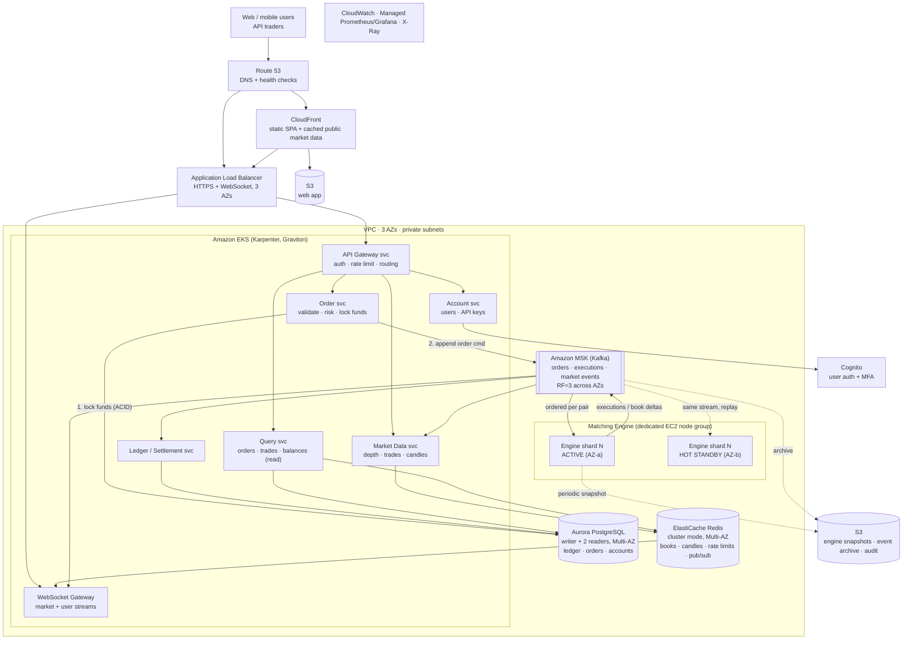
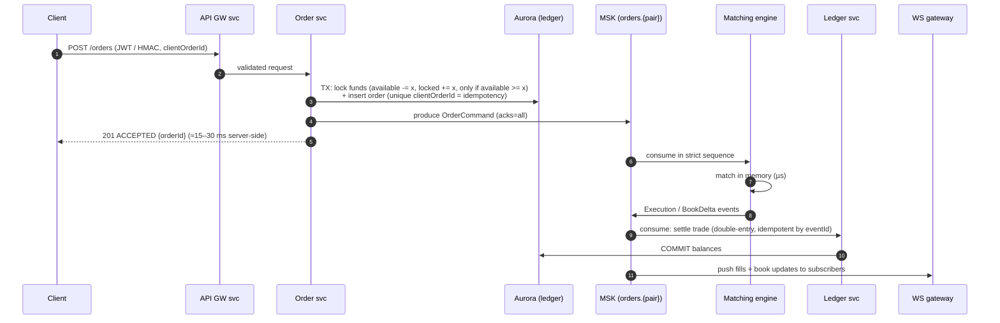

# Problem 1 — Building Castle In The Cloud

A highly available, scalable, cost-aware **spot-trading platform** (Binance-like) on AWS, sized for **500 requests/second** at **p99 < 100 ms**.

## 1. Scope and assumptions

**Features in scope.** I picked these because they exercise every hard infrastructure problem: ordering, consistency, low latency, fan-out and recovery.

| Feature | Notes |
|---|---|
| Sign-up / login / API keys | Web users (JWT) and programmatic traders (HMAC API keys) |
| **Spot trading** | Limit and market orders, cancel, order status |
| **Matching engine** | Price-time priority, per trading pair |
| **Wallet / ledger** | Balances, funds locked on order placement, settlement on trade |
| **Market data** | Order book depth, recent trades, candles (REST + WebSocket push) |
| Order & trade history | Per user |

**Out of scope:** on-chain deposits/withdrawals (custody, hot/cold wallets), futures/margin, fiat rails, KYC vendors, admin back-office. The design leaves clear seams for them (they consume or produce the same event stream).

**Assumptions**

| # | Assumption |
|---|---|
| A1 | **500 RPS** is the HTTP API total. Assumed mix: 60% market-data reads, 30% order place/cancel, 10% account/history. **WebSocket** streams are measured separately (sized for ~20k concurrent connections at launch). |
| A2 | **p99 < 100 ms is measured server-side** (ALB in → response out). Client internet RTT can't be controlled; users far from the region add their own RTT. |
| A3 | Single primary region **ap-southeast-1 (Singapore)**, close to the Asian user base, with **3 Availability Zones**. |
| A4 | The ledger must be **strongly consistent**: no double spend, no lost trade. Availability matters, but **correctness wins**. During some failures the system rejects new orders (503, retryable) rather than risk inconsistency. |
| A5 | Launch with ~200 trading pairs; a handful (BTC/USDT, ETH/USDT) carry most volume. |

## 2. Architecture overview

### Order lifecycle (the critical path)

**Latency budget for `POST /orders` (p99, server-side):**

| Step | Budget |
|---|---|
| ALB + API gateway service (auth, rate limit in Redis) | ~5 ms |
| Order service validation + Aurora transaction (single-row conditional update + insert) | ~10 ms |
| Kafka produce, `acks=all`, cross-AZ replication | ~10 ms |
| Headroom (GC, network jitter, retries) | ~30 ms |
| **Total target** | **≈ 55 ms, comfortably under 100 ms** |

Market-data reads hit Redis (~1–2 ms) or are served from CloudFront for public endpoints, so they sit far below the budget. The engine itself matches in microseconds; the asynchronous hop to a fill notification typically takes 10–30 ms.

## 3. Why each service — and what I considered instead

| Role | Choice | Why | Alternatives considered |
|---|---|---|---|
| DNS / failover | **Route 53** | Health-checked records; enables the DR failover in §5 | — |
| Edge / static | **CloudFront + S3** | Serves the SPA globally. Caches public market-data REST (`/depth`, `/ticker`) for 0.5–1 s, absorbing bursts without touching the cluster | Serving static files from the cluster: more cost, worse latency |
| Ingress | **ALB** | Native WebSocket, path routing, cheap at steady 500 RPS, integrates with WAF/ACM | **API Gateway**: adds latency and per-request cost; WebSocket API has connection-duration limits that hurt long-lived market streams. **NLB**: lowest latency but no L7 routing; worth adding later for a dedicated FIX/WS endpoint for market makers |
| Compute (stateless services) | **EKS + Karpenter on Graviton** | One platform for ~8 services; HPA + Karpenter scale in seconds; Graviton ≈ 20–40% cheaper; portable; mature GitOps (Argo CD) | **ECS Fargate**: simpler ops, but less control over placement/node types (which the engine needs) and pricier per vCPU at steady load. **Lambda**: cold starts and per-invoke cost wrong for a latency-critical steady workload |
| Matching engine | **Dedicated EC2 node group** (c7g, compute-optimised), **single-threaded per pair shard**, active + hot standby in another AZ | Matching must be **sequential per pair** for price-time fairness; in-memory and single-threaded is the industry pattern (LMAX). Deterministic: replaying the same command stream gives the same book, so a standby that consumes the same partition can take over at the last offset | Matching in the database (row locks): far too slow under contention. Multi-threaded engine: harder to make correct and deterministic |
| Event backbone | **Amazon MSK (Kafka)**, 3 brokers / 3 AZs, RF=3, `min.insync.replicas=2` | **Total order per partition** (partition = trading pair), durable replayable log (engine recovery, rebuilding read models, audit), single-digit-ms produce latency, high throughput headroom | **Kinesis**: polling-based consumers add tens of ms of latency; per-shard limits. **SQS FIFO**: no replay, throughput caps per message group. **Self-managed Kafka/Redpanda on EC2**: cheaper at scale, but ops burden at launch |
| System of record | **Aurora PostgreSQL**, Multi-AZ (1 writer + 2 readers) | ACID transactions for the ledger (double-entry, conditional updates, unique constraints for idempotency); failover typically < 30 s; readers serve history queries; storage auto-grows across 3 AZs | **DynamoDB**: superb scale, but multi-item transactions are limited and costlier, and relational ledger queries/audits get awkward. **RDS PostgreSQL Multi-AZ**: cheaper, but slower failover and no fast read replicas on shared storage |
| Cache / real-time state | **ElastiCache for Redis** (cluster mode, Multi-AZ) | Order book snapshots, candles, rate-limit counters, pub/sub fan-out to WS gateways, sub-ms latency. All state is **rebuildable from Kafka**, so durability isn't required | **MemoryDB**: durable Redis; unnecessary since Kafka is the source of truth. **DAX**: DynamoDB-only |
| Identity | **Cognito** for user auth + MFA; API keys (HMAC) in the Account service backed by Aurora | Offloads password storage, MFA, brute-force protection | Auth0/Okta (third-party dependency + cost), self-built auth (risk) |
| Snapshots / archive | **S3** | Engine snapshots (fast restart: snapshot + replay since offset), Kafka archive, audit logs; lifecycle to Glacier | EFS: pricier, no lifecycle tiers needed |
| Observability | **CloudWatch, Amazon Managed Prometheus + Grafana, X-Ray/OpenTelemetry** | SLO dashboards (p99 per endpoint, Kafka consumer lag, engine sequence gap), alerting | Self-hosted Prometheus/Grafana: more ops; Datadog: excellent but cost scales with hosts |
| Delivery | GitHub Actions → ECR → **Argo CD** (GitOps); Terraform for infra | Reproducible, auditable, easy rollback (see Problem 4) | — |

### Networking

- One VPC, 3 AZs. **Public subnets**: ALB and NAT gateways only. **Private app subnets**: EKS nodes and the engine. **Isolated data subnets**: Aurora, MSK and Redis, with no route to the internet.
- **VPC endpoints** (S3, ECR, STS, Secrets Manager, CloudWatch) keep AWS traffic off NAT. This is cheaper and more secure.
- Topology-aware routing in EKS keeps calls within the AZ where possible, which cuts latency and cross-AZ data charges.

## 4. How it stays highly available

| Failure | What happens | Impact |
|---|---|---|
| A pod / node dies | Kubernetes reschedules; ≥3 replicas per stateless service spread across AZs (topology spread + PodDisruptionBudgets) | None visible |
| **A whole AZ fails** | ALB stops routing there; Karpenter adds capacity in the remaining AZs; MSK keeps quorum (2 of 3); Aurora fails over to a reader in another AZ; Redis promotes a replica; the engine **standby in another AZ becomes active** | Seconds of elevated latency; in-flight order requests may need a client retry (idempotent via `clientOrderId`) |
| **Matching engine crash** | Standby already consumed the same partition and holds the identical book. It takes over leadership (single-writer lease) and continues from the last committed offset. A cold restart = load latest S3 snapshot + replay Kafka from its offset | ~1–5 s pause in matching for affected pairs; no lost orders |
| Aurora writer failover | New orders get a fast, retryable `503` (circuit breaker) for the failover window (typically < 30 s). Matching and market data keep running; settlement consumers pause and resume from their Kafka offsets | Short order-entry pause; ledger stays consistent |
| Kafka broker loss | RF=3 + `min.insync.replicas=2`: producers/consumers continue | None visible |
| Redis node loss | Replica promoted; caches rebuilt from Kafka | Brief cache misses |
| Bad deploy | Canary/rolling with automated rollback on SLO burn (Argo Rollouts); engine releases use the standby: upgrade standby → verify replay determinism → switch | Contained |
| **Region loss** | DR to a **warm standby region** (e.g., ap-northeast-1): Aurora Global Database (RPO ~1 s), MSK Replicator for the event log, Terraform-provisioned scaled-down EKS. **Failover is a deliberate, manual decision**: an exchange must not run split-brain with two order books | Trading halted until failover (RTO target ~30 min); RPO ~seconds |

**Design principles behind this**
- **Single source of truth = the event log.** Every read model (order books, candles, history, balances cache) can be rebuilt by replay.
- **Idempotency everywhere.** `clientOrderId` on writes; `eventId` dedupe in consumers. Retries are always safe.
- **Backpressure and graceful degradation.** Rate limits per user/API key at the gateway, circuit breakers, and shedding of non-critical work (history, candles) before order entry.

## 5. Cost-effectiveness

500 RPS is modest. The design targets **steady, right-sized capacity with headroom**, not huge fleets.

| Component | Launch size | Approx. monthly (on-demand, ap-southeast-1) |
|---|---|---|
| EKS control plane | 1 cluster | ~$75 |
| App nodes | 6 × m7g.large (2 per AZ), Karpenter-managed | ~$400 |
| Matching engine | 2 × c7g.xlarge (active + standby) | ~$230 |
| MSK | 3 × kafka.m7g.large + storage | ~$650 |
| Aurora PostgreSQL | 3 × db.r7g.large (I/O-Optimized) | ~$950 |
| ElastiCache Redis | 3 × cache.r7g.large (primary + replicas) | ~$550 |
| ALB, NAT (3), CloudFront, data transfer | — | ~$300 |
| Observability, logs, S3, Secrets, KMS | — | ~$300 |
| **Total** | | **≈ $3.5k / month** (≈ $2.4k with 1-yr Savings Plans / RIs) |

> Rough order of magnitude for planning. I'd confirm with the AWS Pricing Calculator and real load tests.

**Levers:**
- **Graviton** everywhere.
- **Compute Savings Plans** for the steady baseline.
- **Spot** for stateless, interruption-tolerant workloads only (candle builders, history projections). Never for the engine, ledger or gateways.
- **Tiered storage** for Kafka; S3 lifecycle rules.
- **CloudFront caching** of public market data.
- **VPC endpoints** to cut NAT data charges.
- Scale-to-baseline overnight for non-trading services.

## 6. Scaling beyond the current setup

Scale is driven by **signals**, not guesses:
- p99 latency per endpoint
- CPU > 60% sustained
- Kafka consumer lag
- engine queue depth / matching latency
- Aurora CPU and commit latency
- Redis memory
- WebSocket connections per pod

| Stage | Load | What changes |
|---|---|---|
| **1 — Launch** (this design) | 500 RPS, ~20k WS | As above |
| **2 — Growth** | ~5k RPS, ~200k WS | **Horizontal** scaling of stateless services (HPA + Karpenter). More Kafka **partitions**, with pairs spread across **more engine shards** (each shard owns a set of pairs; hot pairs like BTC/USDT get a dedicated shard). **RDS Proxy** + more Aurora readers. Redis shards. A separate WS gateway fleet behind an NLB with fan-out through Redis/Kafka. Longer CloudFront caching of public data. |
| **3 — Scale-out** | ~50k RPS, millions of WS | **Shard the ledger by account ID** (multiple Aurora clusters behind a routing layer, or a distributed SQL engine), since the single writer becomes the bottleneck. **Cell-based architecture**: independent cells of gateways, order services and ledger shards, limiting the blast radius. Engine hosts move to **cluster placement groups** with low-latency tuning (CPU pinning, kernel bypass). A dedicated **FIX / colocation-style endpoint** for market makers. Read-only market data replicated to **edge regions** for global users. |
| **4 — Global** | Multi-region | Active-active for non-trading services (accounts, market data distribution). Order books stay **single-homed per trading pair** (a pair's book lives in one region) to preserve strict ordering. Users are routed by latency, and order entry is forwarded to the home region of the pair. |

**What I would load-test before launch:**
- 3× the expected peak (1,500 RPS)
- a 10× burst on a single hot pair
- AZ evacuation (kill an AZ during load)
- engine failover during load
- Aurora failover during load

Each one is checked against the p99 SLO and zero ledger discrepancies, the latter verified by a reconciliation job that recomputes balances from the event log.

Security is woven into this design in **Problem 5**.
