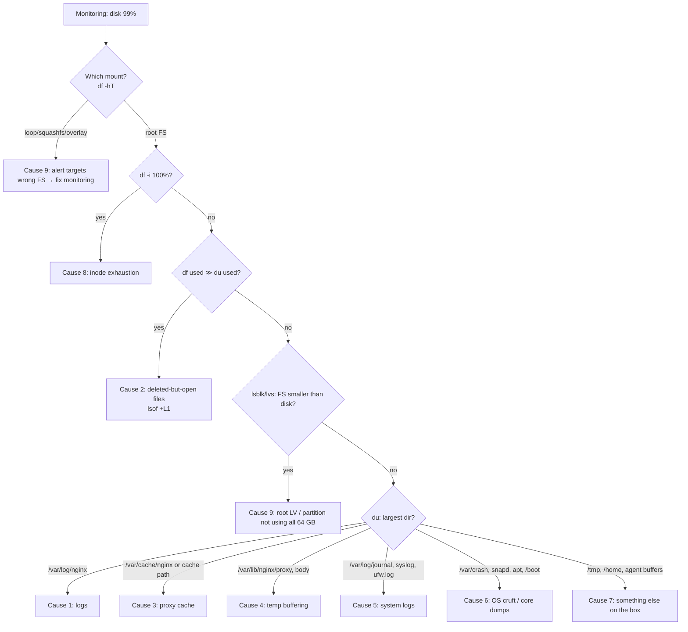

# Problem 2 — Diagnose Me Doctor

**Scenario:** Ubuntu 24.04 VM, 64 GB disk, running only NGINX as a load balancer / traffic router. Monitoring says storage is **consistently at 99%**.

> **Note on the brief:** the task says "two production issues", but the page describes only one scenario. I treat it as one incident and cover it in depth, including the *second* problem it usually hides: whatever made the disk fill up is often also hurting traffic or observability. If a second scenario was intended, I'm happy to add it.

I've also included [`disk-triage.sh`](./disk-triage.sh), a **read-only** script that runs every diagnostic command below in one go. I tested it on Ubuntu 24.04 with nginx, including a simulated "deleted but still open" access log, which it detected and sized correctly.

## 1. First 5 minutes: stabilise, don't make it worse

At 99% of 64 GB there's ~600 MB left. A traffic burst can eat that in minutes. **This box is a single point of failure for every upstream service**, so the priority is to buy headroom safely, then find the cause.

1. **Check the trend, not just the number.** Is usage flat at 99% (a plateau: something is *capped* there) or climbing (something is *growing*)? The monitoring graph decides the urgency. "Consistently 99%" hints at a plateau (see causes 3 and 9).
2. **Confirm the real impact right now:**
   ```bash
   tail -n 50 /var/log/nginx/error.log | grep -i "no space left"   # nginx already failing writes?
   curl -s -o /dev/null -w '%{http_code}\n' http://127.0.0.1/      # still serving?
   ```
3. **Free safe headroom** (no risk to traffic) if it's climbing:
   ```bash
   journalctl --vacuum-size=200M
   apt-get clean
   ```
4. **Things I would *not* do:**
   - **`rm` a log file nginx has open.** The space isn't freed (cause 2).
   - **Reboot "to fix it".** It frees deleted-open files but takes the whole platform down, and the root cause remains.
   - **Delete the nginx cache blindly at peak.** It sends every request to the upstreams at once.
5. **Communicate:** post a short status in the incident channel (impact, ETA for the next update).

## 2. Diagnose: narrow down in this order

```bash
# a) Which filesystem is full? Monitoring may be looking at the wrong thing.
df -hT -x tmpfs -x devtmpfs -x squashfs -x overlay
df -i                                      # inodes can run out with space left

# b) Is the 64 GB disk even fully used by the root filesystem?
lsblk ; vgs ; lvs                          # unallocated LVM space? un-grown partition?

# c) Do df and du agree? A big gap = deleted files still held open.
df -B1 --output=used / ; du -sxB1 /
lsof -nP +L1 | grep -i nginx               # files deleted but still open

# d) Where is the space?
du -xh --max-depth=2 / 2>/dev/null | sort -rh | head -20
find / -xdev -type f -size +200M -exec ls -lh {} + 2>/dev/null | sort -k5 -rh | head
find / -xdev -type f -size +50M -mmin -1440 2>/dev/null   # what grew in the last day

# e) What does nginx write, and where?
nginx -T | grep -E 'access_log|error_log|proxy_cache_path|proxy_temp_path|client_body_temp_path|proxy_max_temp_file_size'
du -sh /var/log/nginx /var/lib/nginx/* /var/cache/nginx 2>/dev/null
cat /etc/logrotate.d/nginx ; grep nginx /var/lib/logrotate/status ; journalctl -u logrotate -p warning --since -3d

# f) The OS itself
journalctl --disk-usage ; du -sh /var/log/* | sort -rh | head
du -sh /var/crash /var/lib/systemd/coredump /var/cache/apt /var/lib/snapd
snap list --all | grep disabled ; dpkg -l 'linux-image-*' | grep ^ii
```

Decision flow:



## 3. Likely causes: how to confirm, impact, recovery

Ordered by how often I'd expect each one on a box that "only runs nginx".

### Cause 1 — NGINX access/error logs growing without bound (most likely)

**Why it happens:**
- `logrotate` isn't covering the files: a custom path like `/var/log/nginx/upstreams/*.log` or `/data/logs/*.log` isn't matched by `/etc/logrotate.d/nginx`.
- Rotation is daily but traffic produces GBs per day.
- `error_log ... debug` (or `info`) was left on after debugging.
- Rotation fails silently because there's no space to compress (`compress` needs room).
- Per-request logging of health checks from the cloud LB / monitoring.

**Confirm:** `ls -lhS /var/log/nginx`, `nginx -T | grep _log`, `logrotate -d /etc/logrotate.d/nginx` (dry run), `/var/lib/logrotate/status`.

**Impact:**
- At 100%, nginx can't write logs. Requests are still proxied, but you **lose traffic visibility and the audit trail**, exactly when you need them.
- Anything else on the box that writes to disk starts failing: certificate renewal, package updates, journald.

**Recovery:**
```bash
# Empty the live file in place. nginx keeps its file descriptor, so space is freed at once.
truncate -s 0 /var/log/nginx/access.log         # (copy/ship the tail first if it's needed)
# Compress or ship old rotated files instead of deleting, if retention matters:
gzip /var/log/nginx/*.log.1
```

**Permanent fix:**
- `logrotate` with `daily` + **`maxsize 1G`** (rotate early on busy days), `rotate 7`, `compress`, `delaycompress`, and `postrotate` → `invoke-rc.d nginx rotate` (this sends `USR1` to reopen logs).
- Run it hourly via `logrotate.timer` so `maxsize` actually triggers.
- `error_log /var/log/nginx/error.log warn;`
- `access_log off;` for health-check locations.
- Buffered logging: `access_log ... buffer=64k flush=5s;`.
- **Ship logs off the box** (Vector, Fluent Bit, CloudWatch agent) and keep only a few days locally.

### Cause 2 — Deleted log files still held open by nginx ("df says full, du says no")

**Why it happens:**
- Someone ran `rm access.log` to free space.
- Or logrotate's `postrotate` signal didn't run or failed.
- nginx workers keep writing to the deleted inode. The space is only released when the file descriptor closes.

**Confirm:** `df` used is much larger than `du -sx /` used; `lsof -nP +L1` lists `/var/log/nginx/*.log (deleted)` owned by nginx. (`disk-triage.sh` section 3 prints both numbers and the gap.)

**Impact:**
- Space never comes back, so the disk "mysteriously" stays full even after cleanup.
- New logs go into a deleted file nobody can read. **Silent loss of logs.**

**Recovery:**
```bash
nginx -t && nginx -s reopen          # or: systemctl reload nginx (graceful, no dropped connections)
# Last resort, if a process can't reopen: empty the deleted file through /proc
: > /proc/<pid>/fd/<fd>
```

**Permanent fix:**
- Never `rm` live logs; use `truncate`.
- Make sure logrotate's `postrotate` reopens nginx, or use `copytruncate` for apps that can't reopen.
- Alert on a `df`/`du` divergence.

### Cause 3 — NGINX proxy cache filling the disk (the classic "constant 99%" plateau)

**Why it happens:**
- `proxy_cache_path` has **no `max_size`**, or a `max_size` close to the disk size, and it lives on the root filesystem.
- nginx's cache manager fills the cache to its limit and holds it there. The disk sits at 99% "by design" until something else needs space.

**Confirm:**
- `nginx -T | grep proxy_cache_path` and `du -sh <cache dir>`.
- Usage is flat rather than growing.
- `ls <cache dir> | wc -l` is huge (also check `df -i`).

**Impact:**
- Logs, temp files and OS updates compete with the cache and fail.
- Under real pressure, nginx can't write new cache entries, so **origin load jumps**.
- Cache writes fail with `ENOSPC` errors in `error.log`.

**Recovery:**
```bash
# Set a limit and a free-space floor, then reload. The cache manager evicts down to it gradually.
#   proxy_cache_path /var/cache/nginx levels=1:2 keys_zone=edge:100m
#                    max_size=20g min_free=5g inactive=24h use_temp_path=off;
nginx -t && systemctl reload nginx
# If space is needed NOW: delete part of the cache (oldest first) off-peak. nginx tolerates it,
# but every purged object becomes an origin request.
find /var/cache/nginx -type f -mmin +720 -delete
```

**Permanent fix:**
- Put the cache on a **dedicated volume** (or tmpfs for small, hot caches) so it can never starve the OS.
- Always set `max_size` and `min_free` (nginx ≥ 1.19.1; Ubuntu 24.04 ships 1.24).
- Alert on cache-volume usage separately.

### Cause 4 — Proxy / client-body temp files (buffering large responses or uploads)

**Why it happens:**
- With `proxy_buffering on`, responses larger than the memory buffers are spooled to `/var/lib/nginx/proxy`, **up to `proxy_max_temp_file_size` (default 1 GB) per request**.
- Large uploads are spooled to `/var/lib/nginx/body`.
- Many concurrent large downloads (exports, media, backups through the LB) cause big bursts.
- Worker crashes can leave orphaned temp files behind.

**Confirm:** `du -sh /var/lib/nginx/*`, `ls -lt /var/lib/nginx/proxy | head`, error-log lines like `an upstream response is buffered to a temporary file`.

**Impact:**
- When the disk is full, those requests fail with **502/500** (`No space left on device ... while reading upstream`).
- **This is the "second production issue" users actually feel.**

**Recovery:**
```bash
# Only remove orphans (old files); active temp files belong to in-flight requests.
find /var/lib/nginx/proxy /var/lib/nginx/body -type f -mmin +60 -delete
```

**Permanent fix:**
- For streaming/large endpoints: `proxy_buffering off;` or `proxy_max_temp_file_size 0;`, plus `proxy_request_buffering off;` for uploads.
- A sensible `client_max_body_size`.
- Point temp paths to a dedicated volume.
- Move large-file traffic off the LB entirely (pre-signed S3 URLs).

### Cause 5 — System logs: journald, syslog, kernel / UFW flood

**Why it happens:**
- `error_log syslog:` or rsyslog **duplicating** nginx logs into `/var/log/syslog`.
- A public LB under constant scanning with **UFW logging on** writes every blocked packet to `kern.log`/`ufw.log`.
- `nf_conntrack: table full, dropping packet` spam.
- journald defaults allow up to 10% of the filesystem (capped at 4 GB), *in addition to* rsyslog's copies.

**Confirm:** `journalctl --disk-usage`, `du -sh /var/log/{syslog,kern.log,ufw.log}*`, `journalctl -p warning --since -1h | head`.

**Impact:**
- Disk pressure.
- A conntrack-table-full flood also means **dropped connections**: a real traffic problem hiding behind a disk alert.

**Recovery:**
```bash
journalctl --vacuum-size=500M
truncate -s 0 /var/log/ufw.log
ufw logging low   # or off
```

**Permanent fix:**
- `SystemMaxUse=1G` in `journald.conf`.
- Don't log nginx to both file and syslog.
- Rate-limit kernel logging.
- Raise `nf_conntrack_max` if it's genuinely full.
- Size-based rotation for rsyslog files.

### Cause 6 — OS cruft and crash dumps

**Why it happens:**
- Old kernels accumulate (`/boot` and `/usr/lib/modules`).
- `/var/cache/apt` fills up.
- **snap keeps multiple revisions** of each snap.
- **Core dumps** pile up in `/var/crash` (apport) or `/var/lib/systemd/coredump` when nginx workers, or something else, keep crashing.

**Confirm:** `du -sh /var/crash /var/lib/systemd/coredump /var/cache/apt /var/lib/snapd`, `snap list --all | grep disabled`, `dpkg -l 'linux-image-*'`.

**Impact:**
- Usually slow growth.
- But **repeated core dumps mean a crashing process**. That's a reliability bug, not just a disk issue.

**Recovery:**
```bash
apt-get clean && apt-get autoremove --purge
snap set system refresh.retain=2
snap list --all | awk '/disabled/{print $1, $3}' | while read n r; do snap remove "$n" --revision="$r"; done
# Core dumps: keep one for analysis, then delete; investigate the crash (coredumpctl list / info)
```

**Permanent fix:**
- Unattended upgrades with `Remove-Unused-Kernel-Packages "true"`.
- Cap core dumps (`/etc/systemd/coredump.conf` `MaxUse=1G`).
- Monitor process restarts.

### Cause 7 — Something that isn't nginx

**Examples:**
- A forgotten `tcpdump` capture in `/tmp` or `/root`.
- Config backup tarballs, or a database/backup someone copied to the LB.
- Deployment artifacts.
- Docker images, if it's ever been installed.
- **A log-shipping agent's offline buffer** (Fluent Bit, CloudWatch agent, Filebeat) growing because the destination is unreachable. A very common one: the "fix" for logs became the problem.

**Confirm:** `du -xh --max-depth=2 /` points outside nginx paths; `find / -xdev -size +200M`; check the agent's buffer directory and its connectivity.

**Impact:** depends on what it is. The agent case also means **logs aren't reaching the central store**.

**Recovery:**
- Identify the owner before deleting.
- Archive to object storage if unsure.
- Fix the agent's destination and set a buffer limit (e.g., Fluent Bit `storage.total_limit_size`).

**Permanent fix:**
- Immutable / config-managed hosts (no hand-copied files).
- Agents with bounded buffers.
- `/tmp` cleaned by `systemd-tmpfiles`.

### Cause 8 — Inode exhaustion (variant)

**Why it happens:** millions of tiny files, typically **cache entries** with deep `levels=`, or session/temp files. `df -h` may look fine while `df -i` is 100%. Some monitoring agents report either one as "disk full".

**Impact:** identical to a full disk (`No space left on device`).

**Recovery:** same as cause 3 or 4, depending on where the files are.

**Permanent fix:**
- Cache on its own filesystem (XFS allocates inodes dynamically).
- Monitor inodes as a separate metric.

### Cause 9 — The disk isn't really "full" the way the alert implies

**Possibilities:**
- **Wrong filesystem in the alert.** Snap `squashfs` loop mounts *always* report 100%, and overlay mounts can mirror the host. Exclude them in the monitoring config.
- **The root filesystem doesn't use the whole 64 GB.** Ubuntu's server installer, with its default LVM layout, can leave part of the volume group unallocated. A cloud disk may also have been enlarged without growing the partition and filesystem. `lsblk`/`vgs`/`lvs` show it immediately.
- **ext4 reserved blocks.** 5% is reserved for root, so "99%" of the *usable* space isn't 99% of the device. That's correct behaviour, but worth knowing when reading the numbers.

**Impact:** a false or misleading alert (alert fatigue), or a needlessly small root filesystem that fills early.

**Recovery:**
```bash
lvextend -r -l +100%FREE /dev/ubuntu-vg/ubuntu-lv          # online, grows LV and ext4 together
growpart /dev/sda 1 && resize2fs /dev/sda1                 # cloud disk grown, partition not
```

**Permanent fix:** correct monitoring filters, IaC/AMI with sensible partitioning, alerts on *usable* space.

## 4. Impact summary: what breaks when this LB's disk hits 100%

| Area | Effect |
|---|---|
| **Traffic** | Requests needing temp files (large responses or uploads) fail with 5xx; cache can't store new objects → more origin load. Simple small requests usually keep working, so it looks "partially broken" |
| **Observability** | Access/error logs stop being written → no visibility or audit trail mid-incident |
| **Security** | Certificate renewals (certbot/ACME) fail → **future TLS outage** when the certificate expires; security updates can't install |
| **Operations** | Config deploys / `nginx -t` with includes may fail; journald stops; logins and `sudo` can misbehave |
| **Blast radius** | This VM fronts **all** upstream services, so anything above is a platform-wide incident |

## 5. Prevention: what I'd put in place afterwards

1. **Alerting that predicts, not just reports:**
   - Warn at 75%, page at 85% of *usable* space, per mount.
   - Alert on **time-to-full**, e.g. Prometheus `predict_linear(node_filesystem_avail_bytes[6h], 4*3600) < 0`.
   - Alert on inodes, a `df`/`du` gap, and a growing nginx temp/cache directory.
   - Exclude squashfs/overlay mounts.
2. **Separate volumes:** `/var/log` and the nginx cache/temp paths on their own volumes. A runaway log or cache can't take down the OS.
3. **Logs are streams, not files:**
   - Ship to central logging.
   - Keep ~3 days locally.
   - Use size-based rotation (`maxsize`), run hourly.
   - Test rotation (`logrotate -d`) in CI or config management.
4. **Bounded everything:** cache `max_size` + `min_free`, journald `SystemMaxUse`, coredump `MaxUse`, agent buffer limits, snap `refresh.retain=2`.
5. **Config management / immutable images** (Ansible or Packer + Terraform). Nothing is hand-edited or hand-copied onto the LB; the fix lands in code, so it can't regress.
6. **Remove the single point of failure:** run ≥ 2 nginx instances behind a cloud load balancer (or replace the self-managed LB with a managed ALB/NLB), so maintenance like this is never an outage.
7. **Postmortem:** blameless. Each root cause becomes a monitoring rule or a config-management change.
