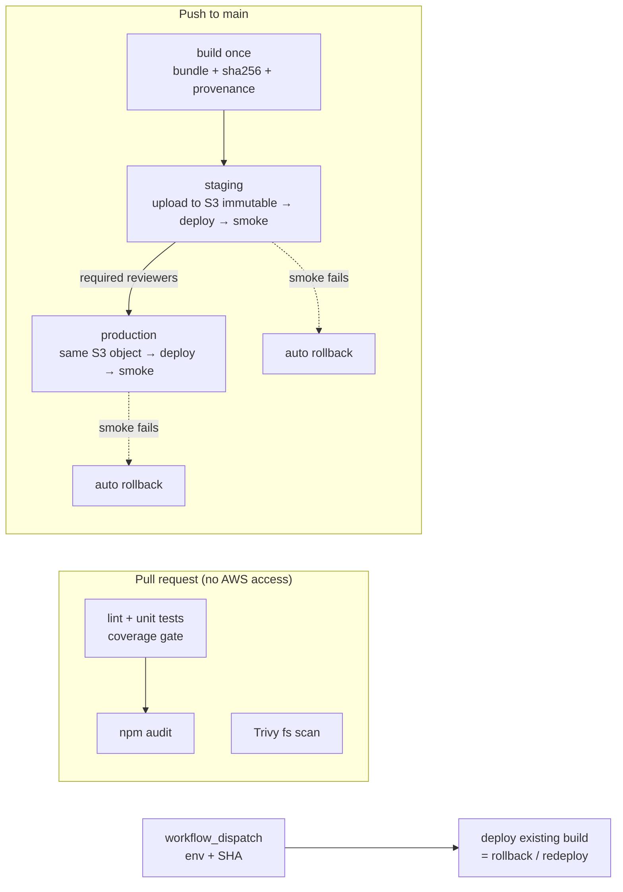

# Problem 4 — Ship It Twice

Production CI/CD for two applications with GitHub Actions:

- **Backend**: HTTP API on **EC2**, deployed via an immutable S3 bundle and **AWS CodeDeploy**.
- **Frontend**: static SPA on **S3 + CloudFront**.

```
src/problem4/                     <- treat this folder as the repository root
├── .github/
│   ├── workflows/
│   │   ├── backend.yml           # backend pipeline (PR / main / manual)
│   │   ├── _deploy-backend.yml   # reusable: deploy one version to one environment
│   │   ├── frontend.yml          # frontend pipeline
│   │   ├── _deploy-frontend.yml  # reusable: deploy one version to one environment
│   │   └── lint-pipelines.yml    # actionlint + shellcheck for the pipelines themselves
│   ├── dependabot.yml
│   └── CODEOWNERS
├── backend/                      # sample Express API + tests + CodeDeploy files
│   └── deploy/                   # appspec.yml, lifecycle hooks, hardened systemd unit
├── frontend/                     # sample Vite SPA + tests
├── scripts/                      # deploy-backend.sh, publish-frontend.sh, smoke-test.sh
└── infra/iam/                    # OIDC trust + least-privilege deploy policies (examples)
```

> GitHub only runs workflows from `<repo root>/.github/workflows`. The template puts them in `src/problem4/.github/workflows`, so all paths are written **relative to `src/problem4/`**. Copy that folder into its own repository (or move `.github/` up and prefix the paths) and the pipelines run as-is.

## What "production ready" means here

I defined it as these properties and built each one into the pipelines:

| Property | How |
|---|---|
| **Nothing reaches users untested** | PRs run lint, unit tests with an 80% coverage gate, a dependency audit, and a Trivy scan (vulns, secrets, misconfig). Deploys need all of them green. Branch protection on `main` makes these required checks. |
| **Build once, promote the same bytes** | One artifact per commit, named by full git SHA. Staging uploads it to an S3 artifact bucket with a **conditional write** (`--if-none-match '*'`), so a version can never be overwritten. Production deploys that exact object. The frontend gets per-environment config from `/config.json` at deploy time, so the build stays environment-agnostic. |
| **Verifiable artifacts** | SHA-256 checked between jobs. Signed SLSA build provenance via `actions/attest-build-provenance`. `/version` and `/version.json` report the live SHA. |
| **No long-lived cloud credentials** | GitHub OIDC → `AssumeRoleWithWebIdentity`. Each environment has its own role, and its trust policy is pinned to `repo:<org>/<repo>:environment:<env>`. A PR or another branch cannot assume the production role. |
| **Least privilege** | Workflow default `contents: read`; jobs opt in to `id-token`/`attestations`. IAM policies are scoped to one deployment group, bucket and distribution (`infra/iam/`). The production role can only *read* artifacts. |
| **Human gate for production** | GitHub Environment `production` with required reviewers and a `main`-only deployment branch policy. |
| **Zero-downtime deploys** | Backend: CodeDeploy `OneAtATime` behind the ALB (deregister → drain → stop → install → start → validate → re-register). Atomic symlink switch between versioned release directories. Frontend: hashed assets first, `index.html` last, old assets kept, invalidate only entry points. |
| **Automatic rollback** | (1) CodeDeploy rolls back if a lifecycle hook (`ValidateService` checks the *new* version is serving) or a CloudWatch alarm fails. (2) If the deploy "succeeds" but the external smoke test fails, the workflow redeploys the previously live SHA, recorded before the deploy started. (3) Manual rollback: `workflow_dispatch` with any previously built SHA. |
| **Safe concurrency** | One deploy per environment at a time (`cancel-in-progress: false`, so a deploy is never killed mid-flight). Superseded PR runs are cancelled. |
| **Supply-chain hygiene** | Every third-party action pinned to a **full commit SHA** (tag in a comment). Dependabot keeps SHAs and npm deps current. Lockfiles + `npm ci`. `persist-credentials: false` on checkout. Workflow inputs and remote values pass through `env:` (never inlined into scripts) and are validated as 40-char SHAs. |
| **Pipelines are code** | `lint-pipelines.yml` runs actionlint and shellcheck. CODEOWNERS requires platform review for `.github/`, `scripts/`, `backend/deploy/`. |
| **Observable** | Job summaries (version, previous version, result), deployment URLs on GitHub Environments, CodeDeploy failure diagnostics printed per instance and hook. |

## How the pipelines work



### Backend (`backend.yml` → `_deploy-backend.yml`)

1. **test**: `npm ci`, eslint, `node --test` with coverage gate, `npm audit --omit=dev`.
2. **security-scan**: Trivy on `backend/` (HIGH/CRITICAL, fixable only, fails the build).
3. **build** (main only): `npm ci --omit=dev`, then a self-contained bundle: `src/`, `node_modules/`, `appspec.yml`, hooks, systemd unit, and `build-info.json` (SHA, ref, run id, time). Output is `backend-<sha>.tgz` + checksum + provenance. EC2 hosts never run `npm install`, so they need no npm registry access and can't drift.
4. **deploy-staging** → **deploy-production** (reusable workflow):
   - Validate the SHA and assume the environment's role via OIDC.
   - Staging only: verify the checksum, then put the bundle to `s3://<artifacts>/backend/<sha>.tgz` (conditional write).
   - Confirm the object exists (this is what makes a rollback to an unknown SHA fail fast).
   - Record the **currently live** version from `GET /version` (validated as a SHA).
   - `scripts/deploy-backend.sh`: `create-deployment` + `wait deployment-successful`. On failure it prints the failing hook per instance.
   - **On each instance** (`appspec.yml`): `ApplicationStop` → `BeforeInstall` (clean landing dir, create user, check node) → `AfterInstall` (move to `/opt/backend/releases/<sha>-<deployment-id>`, atomic `current` symlink swap, install unit, keep 5 releases) → `ApplicationStart` (`systemctl restart`) → `ValidateService` (local `/version` must equal the bundle's SHA and `/healthz` must be 200, within 60 s).
   - External smoke test through the ALB: `/version` == SHA, plus `/healthz` and `/api/hello` return 2xx.
   - Smoke failure → redeploy the previous SHA and smoke-test it.
5. **manual-deploy**: pick an environment and an already-built SHA. Skips build and goes straight to the reusable deploy.

The service runs as an unprivileged `backend` user under systemd with `Restart=always` and sandboxing (`ProtectSystem=strict`, `NoNewPrivileges`, empty capability set). Secrets are rendered at boot from SSM/Secrets Manager into `/etc/backend/backend.env` by the instance role, never shipped in the bundle.

### Frontend (`frontend.yml` → `_deploy-frontend.yml`)

1. **build**: lint, tests, `npm audit` (all deps, since they ship to browsers), then `vite build` with the SHA injected. Local `config.json` is removed and `version.json` added, then packaged as `frontend-<sha>.tgz` + checksum (+ provenance on main). Runs on PRs too, so a broken build never merges.
2. **security-scan**: Trivy on `frontend/`.
3. **deploy** (reusable):
   - Staging uploads the release to the artifact bucket; production and rollbacks download it from there, with the checksum verified both ways.
   - Render `config.json` from Environment vars, and check the artifact's `version.json` matches the requested SHA.
   - Record the live version, then run `scripts/publish-frontend.sh`:
     1. `assets/*` with `max-age=31536000, immutable`, never deleted by the deploy.
     2. Other static files with a short cache.
     3. `config.json` / `version.json` with `no-cache`.
     4. **`index.html` last**, with `no-cache`.
     5. CloudFront invalidation of `/`, `/index.html`, `/config.json`, `/version.json` only, and wait for it.
   - Smoke test through CloudFront: `version.json` == SHA; `/`, `/config.json` and the JS entry chunk referenced by `index.html` all return 2xx.
   - Failure → republish the previous release from the artifact bucket.

Old hashed assets are expired by an S3 lifecycle rule (e.g., 30 days) instead of `sync --delete`, so browser tabs still running the previous build don't 404 on lazy-loaded chunks.

## Assumptions (and why)

| Assumption | Why |
|---|---|
| Backend is a **Node.js** API (I wrote a minimal Express app with tests) | The task gives no code. A real, testable app makes the pipeline genuine rather than pseudo-YAML. Swapping the language changes only the test/build steps. |
| EC2 instances live in an **Auto Scaling Group behind an ALB**, AMI has Node 22 and the CodeDeploy agent, instance profile can read the artifact bucket and SSM parameters | Standard for a production EC2 service. Provisioned by IaC outside this repo. |
| **CodeDeploy** rather than SSH or SSM Run Command | SSH means inbound port 22 and a long-lived key in GitHub. SSM Run Command works but you'd re-implement rolling, ALB draining, health gating and rollback yourself. CodeDeploy does all of that natively and auditably. |
| Two environments, **staging → production**, separate AWS accounts or at least separate roles, buckets and deployment groups | The minimum for "test before prod". PR preview environments are noted below as a next step. |
| Frontend is a **static SPA** (no SSR), served by CloudFront with **Origin Access Control** on a private bucket, SPA fallback (403/404 → `/index.html`) on the distribution | Matches "static single-page app deployed to S3". Public buckets are not production-grade. |
| Trunk-based development: `main` is always deployable; merges require PR + green checks + CODEOWNERS review | Makes "every merge goes to staging" safe. |
| Region `ap-southeast-1` and account `111111111111` in the IAM examples | Placeholders. |

### One-time setup

| Where | What |
|---|---|
| Repository variable | `DEPLOY_ENABLED=true`. Until set, deploy jobs are skipped and CI stays green, e.g. for reviewers of this challenge. |
| Environment `staging` | vars `AWS_REGION`, `AWS_DEPLOY_ROLE_ARN`, `ARTIFACT_BUCKET`, `CODEDEPLOY_APP`, `CODEDEPLOY_GROUP`, `BACKEND_URL`, `SITE_BUCKET`, `CLOUDFRONT_DISTRIBUTION_ID`, `SITE_URL`, `FRONTEND_API_BASE_URL` |
| Environment `production` | same vars + **required reviewers** + deployment branch rule `main` |
| AWS | OIDC provider `token.actions.githubusercontent.com`, one role per environment (`infra/iam/`), artifact bucket (versioning, SSE-KMS, lifecycle), CodeDeploy app + group with auto-rollback and alarms |
| Branch protection | require `backend / Lint & test`, `backend / Security scan`, `frontend / Lint, test & build`, `frontend / Security scan`, `lint-pipelines`; require CODEOWNERS review |

## What I verified (no AWS account)

The task says "implement faithfully and explain". Here is what I actually executed:

- **Apps:** backend and frontend lint clean; tests pass (5 + 6) at 100% line coverage; `npm audit` clean; the Vite build works.
- **Workflows:** `actionlint 1.7.12` reports no errors on all five workflows (this includes shellcheck of every `run:` block). `shellcheck` is clean on all scripts and hooks.
- **Backend bundle + CodeDeploy hooks:** built the bundle exactly as the build step does, then ran `before_install` → `after_install` (with a `systemctl` stub) → started the service → `validate_service` on a Linux host. The release dir and atomic symlink were created, validation **passed** for the right SHA and **failed** when the served version didn't match.
- **`deploy-backend.sh`:** ran against a mocked AWS CLI. Success → exit 0. Failure → exit 1 with deployment error, rollback info and the failing hook per instance.
- **`publish-frontend.sh`:** ran against a mocked AWS CLI. The call order is assets → other → config/version → `index.html` → invalidation → wait, as designed.
- **`smoke-test.sh`:** against a locally served release. Passes on the right version and extra URLs; fails (exit 1) on a wrong version.

**Not executed:** anything that needs real AWS (OIDC assume-role, S3, CodeDeploy, CloudFront) or a GitHub-hosted run.

## What I deliberately left out

| Left out | Why / what I'd do |
|---|---|
| **Infrastructure as Code** for the ASG, ALB, CodeDeploy, buckets, CloudFront and IAM | Out of scope for "pipelines" and would double the size. In reality: Terraform/CDK in its own repo with a plan-on-PR / apply-on-merge pipeline. Only the IAM policies are included, because they define the pipeline's trust boundary. |
| **Database migrations** | No DB in the task. I'd run expand/contract migrations as a separate, idempotent step *before* the code deploy, with backward-compatible schema changes so rollback stays safe. |
| **Canary / blue-green with traffic shifting** | `OneAtATime` + health gating + alarm rollback is enough at this size. Next step: CodeDeploy blue/green on the ASG, or ALB weighted target groups for a 10% canary with automated analysis. |
| **Integration / E2E tests** against staging (Playwright, API contract tests) | Would slot in after the staging smoke test and before the production approval. Omitted to keep the samples small. |
| **PR preview environments** for the frontend | Nice to have (a per-PR S3 prefix + CloudFront path). Not required for safe production delivery. |
| **SAST** (CodeQL/Semgrep), DAST, licence scanning | Trivy covers dependencies, secrets and IaC misconfig. CodeQL is a one-file addition, usually enabled org-wide via GitHub Advanced Security. |
| **Container images** | The task says EC2, not ECS. A tarball + CodeDeploy is simpler on plain EC2. If they move to containers: build once → ECR (immutable tags, signed with cosign) → ECS rolling/blue-green. |
| **Serving source maps** | Built for debugging but excluded from S3. I'd upload them to the error tracker (e.g., Sentry) in the build job. |
| **Self-hosted runners** | GitHub-hosted runners are fine. Self-hosted only if deploy targets must be reached from inside the VPC. |
| **Deploy notifications** (Slack, release notes, DORA metrics) | Easy to add as a final job. Left out to keep focus. |
