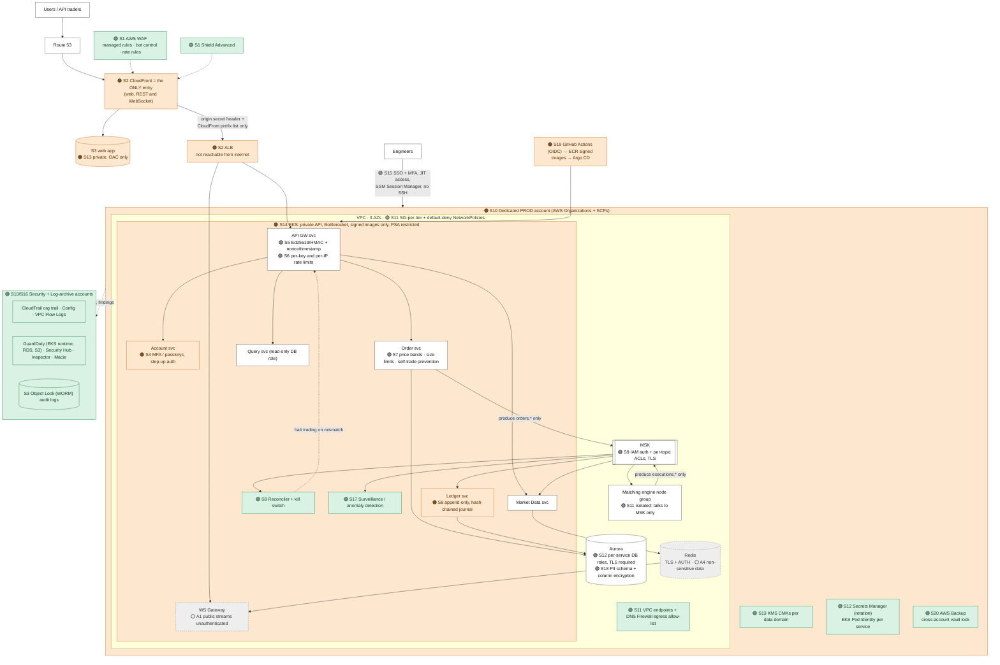

# Problem 5 — Fortify The Castle

This takes the trading platform from **Problem 1** and builds security into the architecture itself. Every change is tagged:

- 🟢 **ADDED**: a new component or control
- 🟠 **CHANGED**: the Problem 1 design was altered
- ⚪ **ACCEPTED**: I looked at the risk and decided to live with it (for now), with the reason

Change IDs (`S1`…`S20`) are used consistently in the diagram and the tables.

## 1. Start from what an attacker wants

For an exchange, the threat model is about **money first**. These are the incidents that have actually sunk exchanges:

| Asset | Worst case | Main attack paths |
|---|---|---|
| **Customer balances (ledger)** | Funds stolen or created out of thin air | Account takeover, stolen API keys, a compromised service writing fake fills/credits, insider changes |
| **Order flow integrity / fairness** | Manipulated or injected orders, front-running | Message injection into the event bus, insider access to the engine, abuse of the API |
| **Availability** | Outage during volatility → losses, regulator scrutiny | DDoS (often with extortion), bot floods on login/order endpoints |
| **Credentials & secrets** | Full environment compromise | Leaked cloud keys, CI/CD supply chain, over-privileged roles |
| **Customer PII / KYC** | Breach, regulatory penalties | Misconfigured storage, over-broad DB access |
| **Audit trail** | Inability to prove what happened | Log tampering by an attacker covering tracks |

**Priority rule I applied:**
1. What directly loses customer money (account takeover, ledger/order integrity).
2. What stops the business (availability, ransomware).
3. Data exposure.
4. Hardening and maturity.

## 2. Updated architecture (security changes marked)

**The three most important design changes compared to Problem 1:**

1. **One front door (S2).** In Problem 1, Route 53 pointed at both CloudFront *and* the ALB. Now **all** traffic, including REST and WebSocket APIs, enters through CloudFront + WAF. The ALB only accepts the CloudFront origin-facing prefix list *and* a secret origin header, so WAF and DDoS protection can't be bypassed by hitting the ALB directly. TLS also terminates at the edge, closer to users, so this costs no latency budget.
2. **The event bus is a trust boundary, not a shared pipe (S9).** Any pod that could write to Kafka could have injected a fake fill and minted money. Now each producer/consumer has its own IAM identity and topic ACL: **only** the Order service can write `orders.*`, **only** the matching engine can write `executions.*`, and the Ledger can only read.
3. **The ledger can prove it's right, and stop the world if it isn't (S8).** The journal is append-only (no `UPDATE`/`DELETE` grants) and hash-chained. An independent reconciler continuously recomputes balances from the event log and compares them with the ledger and engine state. Any mismatch automatically **halts order entry** (kill switch) and pages on-call.

## 3. Every change, why it's there, what it protects against

| ID | Type | Where | Change | Protects against |
|---|---|---|---|---|
| **S1** | 🟢 | Edge | **AWS WAF** on CloudFront: AWS managed core + known-bad-inputs + IP reputation rules, **Bot Control (targeted)** on `/login` and `/signup`, rate-based rules per IP on auth and order endpoints, geo-blocking of sanctioned regions. **Shield Advanced** for L3–L7 DDoS response team support and DDoS cost protection | DDoS and extortion, credential stuffing, scraping, common web exploits |
| **S2** | 🟠 | Edge → ALB | CloudFront is the only entry; ALB locked to the CloudFront prefix list + secret header; TLS 1.2+ only, HSTS | WAF bypass, direct-origin DDoS, downgrade attacks |
| **S3** | 🟢 | Everywhere | **TLS to every data store**: Aurora `rds.force_ssl=1`, MSK TLS, Redis in-transit encryption. East-west pod-to-pod mTLS: see A2 | Sniffing / tampering inside the VPC |
| **S4** | 🟠 | Account svc | **MFA required** (TOTP or **passkeys/WebAuthn**) for login on new devices and for **step-up** on sensitive actions (API key creation, security changes; withdrawals once in scope). Cognito threat protection (compromised-credential detection, adaptive auth). New device/IP → email confirmation. Short-lived JWTs (15 min) + rotating refresh tokens. Anti-phishing code in emails | **Account takeover**, the #1 way exchange customers lose money |
| **S5** | 🟢 | API GW svc | API keys: **Ed25519 (asymmetric) by default**, so the server stores only the public key and a DB leak doesn't leak signing secrets; HMAC kept for compatibility (secret encrypted with KMS). Every signed request carries timestamp + nonce (rejected outside a 5 s window or if replayed). **Scoped keys** (read / trade; withdraw is never enabled for API keys at launch), optional IP allow-list, expiry | Stolen-key abuse, replay attacks, blast radius of a leaked key |
| **S6** | 🟢 | API GW svc | Per-user, per-key and per-IP rate limits (Redis token buckets), separate order-rate limits | Abuse, spoofing/layering floods, resource exhaustion |
| **S7** | 🟢 | Order svc | Server-side **price bands** (reject orders far from the reference price), max order size/notional, **self-trade prevention**, symbol-status checks (halted pairs) | Fat-finger and manipulation attacks, wash trading |
| **S8** | 🟠 | Ledger | Double-entry with DB constraints (`CHECK balance >= 0`, unique `eventId`). Journal table is **append-only** at the DB-grant level, with each row carrying `hash(prev_hash ‖ row)` (tamper-evident). **Reconciler** service + **automated trading halt** on mismatch | Ledger manipulation (external or insider), silent corruption, double spend |
| **S9** | 🟢 | MSK | **IAM authentication** + per-topic ACLs (producer/consumer per service identity), TLS in transit, encryption at rest (CMK) | Fake order/fill injection by a compromised service |
| **S10** | 🟠 | AWS org | Single account → **AWS Organizations**: `prod`, `staging`, `security`, `log-archive`, `shared-services`. **SCPs**: deny disabling CloudTrail/GuardDuty/Config, deny leaving the org, region allow-list, deny root usage, deny IAM user access keys | Blast radius of a compromised account/role, attackers covering tracks |
| **S11** | 🟢 | Network | Security groups per tier referencing each other (no CIDR-wide rules); **Kubernetes NetworkPolicies default-deny** with explicit service-to-service allows; matching-engine nodes can **only** reach MSK; data subnets have **no internet route**; outbound traffic via **VPC endpoints** + **Route 53 Resolver DNS Firewall** allow-list | Lateral movement, data exfiltration, malware command-and-control callbacks |
| **S12** | 🟢 | Workloads | **EKS Pod Identity**: one IAM role per service, nothing on the node role. **Per-service DB roles** (Order: insert orders/update holds; Ledger: insert journal; Query: read-only on replicas). DB credentials in **Secrets Manager with automatic rotation**; no secrets in images, env files or Git | Credential theft, privilege escalation from one compromised pod |
| **S13** | 🟢/🟠 | Data at rest | **KMS customer-managed keys per data domain** (ledger, PII, logs, backups) with key policies separating key admins from key users. S3 Block Public Access at the account level; web bucket private with **Origin Access Control** (🟠 was implicit). EBS/snapshot encryption by default | Data exposure from misconfigured storage or stolen snapshots |
| **S14** | 🟠 | EKS | **Private** cluster API endpoint; Bottlerocket nodes; IMDSv2 required (hop limit 1); Pod Security Admission `restricted`; non-root, read-only root FS; **only signed images from our ECR** (cosign + Kyverno admission); ECR scan on push | Container escape, credential theft via the instance metadata service, running tampered images |
| **S15** | 🟢 | Human access | IAM Identity Center SSO + hardware MFA; **no SSH**, only SSM Session Manager (fully logged); **just-in-time** elevated access with approval and expiry; break-glass roles that alarm when used; no human write access to the production DB (changes via reviewed migrations); **two-person rule** for engine/ledger deploys and config | Insider threat, stolen engineer laptops/credentials |
| **S16** | 🟢 | Detection | Org-wide **CloudTrail** into the log-archive account (S3 **Object Lock**, WORM). **GuardDuty** (incl. EKS runtime, RDS login, S3), **Security Hub** (AWS FSBP + CIS), **AWS Config** conformance packs, **Inspector**, VPC Flow Logs, centralized app/audit logs → SIEM, alerts routed to on-call with runbooks | Undetected compromise; this is how you find what the controls miss |
| **S17** | 🟢 | Application | **Surveillance** consumer on the event stream: rule-based alerts for wash trading, spoofing, unusual withdrawal/login patterns (ML later) | Market abuse, account-takeover patterns |
| **S18** | 🟢 | Data | PII/KYC in a **separate schema** with column-level encryption (CMK), access via a dedicated service only; data minimization (trading services see user IDs, never PII); Macie on S3 | PII breach, over-broad access |
| **S19** | 🟠 | Delivery | Problem 4's controls applied here: GitHub OIDC (no static keys), actions pinned by SHA, SBOM + vulnerability gate, **signed images**, Argo CD pulls into the cluster (no inbound CI credentials), branch protection + CODEOWNERS, 2 approvals for engine/ledger code | Supply-chain compromise, malicious or accidental changes |
| **S20** | 🟢 | Resilience | **AWS Backup** with cross-account and cross-region copies in a **vault-locked** vault; Aurora PITR; Kafka archive in Object Lock S3; quarterly restore drills | Ransomware, destructive insiders, operator error |

**Impact on the Problem 1 constraints:**
- **Latency.** WAF inspection ≈ 1 ms; Ed25519/HMAC verification < 0.1 ms; TLS to data stores is negligible with connection pooling. The `POST /orders` budget (~55 ms target) still clears **p99 < 100 ms**.
- **Cost.** Shield Advanced is ~$3,000/month (+ data transfer) and is the single biggest item. WAF + Bot Control is ~$100–300/month; GuardDuty, Security Hub, Config, Inspector, Macie, KMS and Backup are ~$500–1,000/month at this size. Security adds roughly **+$4k/month** on a ~$3.5k infra bill. That's justified for a platform holding customer funds, but it's a real trade-off (see §5).

## 4. Priorities: what first, what later, and what I refuse to ship without

### Refuse to ship without (launch blockers)

1. **S2 + S1 (WAF part):** one front door with WAF and rate limits on auth and order endpoints.
2. **S4:** MFA for users, at minimum for new devices and every sensitive action; compromised-credential checks.
3. **S5:** signed API requests with replay protection and scoped keys (no withdrawal permission via API).
4. **S8:** ledger integrity controls, continuous reconciliation, a working **kill switch** (tested).
5. **S9:** Kafka authentication + topic ACLs.
6. **S10 + S12 + S15:** separate prod account, per-service least-privilege roles, no long-lived keys, no SSH, SSO + MFA for staff.
7. **S3 + S13:** encryption in transit to every data store and at rest with KMS; nothing public except CloudFront.
8. **S11:** private data tier, default-deny network policies.
9. **S16:** CloudTrail + GuardDuty + alerting to a human on-call, with immutable logs.
10. **S20:** backups with vault lock **and one successful restore test**.
11. An **external penetration test** of the API and auth flows, with all critical/high findings fixed.

### First 90 days after launch
- **S1 Shield Advanced** if launch is a closed beta. It's mandatory before public marketing or listing high-profile pairs (that's when DDoS extortion arrives).
- **S7** full rule set, **S17** surveillance rules, **S18** column-level encryption for KYC fields.
- **S14** image-signing enforcement in *enforce* mode (start in *audit* mode to avoid blocking deploys).
- Security Hub score above an agreed baseline; game-day exercises (key leak, pod compromise, DDoS).

### Deferred, with a trigger to revisit
| Deferred | Revisit when |
|---|---|
| **East-west mTLS / service mesh** (A2) | More than ~15 services, multiple teams, or a regulator requires it |
| **AWS Network Firewall** (deep egress inspection) | When third-party egress grows or compliance requires inspection. DNS Firewall + SG egress rules cover launch for ~1/10 of the cost |
| **Per-message signing on Kafka** | If ACLs + IAM identity are ever judged insufficient (e.g., cross-account producers) |
| **ML-based fraud/surveillance** | Once there is enough labelled data |
| **Bug bounty program** | After the first pen test and 1–2 months of operating maturity |

## 5. Risks I deliberately accepted (and why)

| ID | Accepted risk | Why it's acceptable | Compensating controls |
|---|---|---|---|
| ⚪ **A1** | **Public market-data WebSocket streams are unauthenticated** | It's public data by design (same as every exchange); requiring login would hurt adoption and add load | Per-IP connection + message-rate limits at WAF/gateway; user-specific streams require a signed listen key |
| ⚪ **A2** | **No pod-to-pod mTLS at launch** | A mesh adds latency to the order path, operational complexity and a new failure mode. At ~8 services inside one cluster, the threat is better handled by tight network policy and identity at the data layer | Default-deny NetworkPolicies, SG-per-tier, IAM/ACL auth at Kafka and the DB, TLS to all data stores, GuardDuty EKS runtime monitoring |
| ⚪ **A3** | **Single-region trading** (from Problem 1) | Strict ordering per pair is simpler and safer single-homed; a regional outage halts trading rather than risking split-brain | Warm-standby DR region, tested failover runbook |
| ⚪ **A4** | **Redis holds non-sensitive data** (books, candles, counters) and gets AUTH + TLS but no client-side encryption | All of it is public or rebuildable; encrypting it buys nothing | Private subnet, SG to app tier only, encryption at rest |
| ⚪ **A5** | **Shield Advanced may be deferred during a closed beta** | Limited, known user base; ~$3k/month is significant pre-revenue | WAF rate rules, CloudFront absorption, Shield Standard, runbook to enable Shield Advanced within a day |
| ⚪ **A6** | **Third-party SaaS** (e.g., observability, email) receives some metadata | Operational benefit is high | No PII or secrets in logs (log scrubbing), DPAs with vendors |

## 6. Facts I don't have: what I need, how I'd get it, what I assumed

| Missing fact | Why it matters | How I'd get it | Assumed for now |
|---|---|---|---|
| **Which licences / jurisdictions** the exchange operates under | Drives mandatory controls, data residency, audit retention, pen-test frequency, incident reporting deadlines | Legal / compliance team | Operating under a Singapore-style regime (MAS Technology Risk Management Guidelines + PDPA), so: data stays in-region, 5-year record retention, annual pen test, prompt incident notification |
| **Custody model** (in-house hot/cold wallets vs. a custodian) | It's the biggest theft risk at real exchanges; needs HSM/MPC, withdrawal approval workflows, address allow-lists | Product + security leadership | Out of scope (as in Problem 1). Withdrawals will need their own design: CloudHSM/MPC, delays, step-up + manual review for large amounts |
| **Threat history / DDoS budget** | Sizing of Shield, WAF and incident response | Business; peers' incident reports; threat intel | Assume we'll be DDoS-targeted within months of launch |
| **Staff identity provider** | SSO integration | IT | Google Workspace or Entra ID federated into IAM Identity Center |
| **Risk appetite for halting trading** | Kill-switch thresholds (halt vs. degrade) | Risk committee | Halt on *any* ledger mismatch; investigate before resuming |
| **KYC vendor data flows** | PII storage scope and transfer controls | Compliance + vendor DPIA | KYC documents stay with the vendor; we store a verification status + reference ID only |

## 7. What I left out, and the trade-offs

- **Wallet / custody security** (HSM/MPC, withdrawal approvals, address allow-lists): the most critical area for a real exchange, but out of Problem 1's scope. It's called out above so it isn't forgotten.
- **Full compliance mapping** (MAS TRM / SOC 2 / ISO 27001 control matrices): this design implements most technical controls, but the mapping and evidence collection are a separate workstream.
- **Application-level secure SDLC detail** (threat modelling per feature, SAST/DAST tooling choice, secure code training): beyond SCA/secret/IaC scanning and pen testing, this is mentioned only at a high level.
- **Customer-facing security features** beyond MFA (withdrawal whitelists, anti-phishing codes in all channels, account freeze self-service): good practice, partially listed, not designed in detail.

**Trade-offs I accepted:**
- Security roughly **doubles the monthly run-cost** at launch scale. For a platform holding customer funds, the expected loss from one account-takeover wave or one DDoS during a volatile market dwarfs it.
- The **kill switch favours correctness over availability**: some false positives will halt trading unnecessarily. Consistent with Problem 1's "correctness wins" principle.
- **No service mesh** means less defence in depth inside the cluster in exchange for latency, simplicity and fewer moving parts. Revisited at clear triggers.
