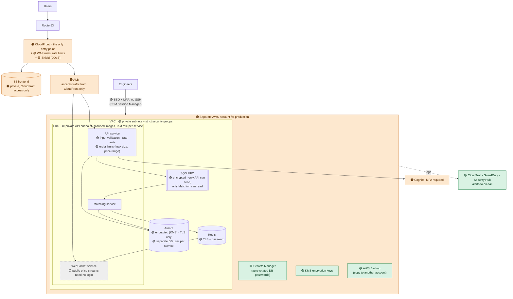

# Problem 5 — Fortify The Castle

This takes the Problem 1 architecture and builds security into it. Each change is marked:

- 🟢 **Added**: a new security component
- 🟠 **Changed**: the Problem 1 design was modified
- ⚪ **Accepted**: a known risk I decided to accept for now, with the reason

## 1. What we are protecting, and in what order

A trading platform holds customer money, so I prioritised in this order:

1. **Customer funds and balances.** Account takeover and unauthorised changes to balances or orders are the most damaging.
2. **Availability.** DDoS or outages during market volatility hurt customers and reputation.
3. **Customer data.** Personal information and login credentials.
4. **General hardening and compliance.**

## 2. Updated architecture

## 3. Security changes and why

### Entry point and DDoS protection

| # | Type | Change | Protects against |
|---|---|---|---|
| 1 | 🟠 | **CloudFront is the only way in.** In Problem 1 the ALB could be reached directly. Now the ALB only accepts traffic from CloudFront (CloudFront IP list + a secret header) | Attackers bypassing WAF and DDoS protection by hitting the ALB directly |
| 2 | 🟢 | **AWS WAF**: AWS managed rule sets, bot protection on login/sign-up, rate limits per IP on login and order endpoints | Credential stuffing, bots, common web attacks |
| 3 | 🟢 | **AWS Shield** (Standard included; Advanced recommended before public launch) | DDoS attacks |
| 4 | 🟢 | HTTPS everywhere (TLS 1.2+, certificates from ACM) | Eavesdropping, tampering |

### User accounts

| # | Type | Change | Protects against |
|---|---|---|---|
| 5 | 🟠 | **MFA required** for login from a new device and for sensitive actions (changing password, creating API keys). Cognito's compromised-password detection enabled | Account takeover, the most common way users lose funds |
| 6 | 🟢 | **API keys** for trading bots: limited permissions (read/trade only), optional IP allow-list, signed requests with a timestamp | Stolen keys being abused or replayed |
| 7 | 🟢 | **Business rules in the API**: maximum order size, reject prices far from the market price, per-user rate limits | Mistaken or abusive orders, system overload |

### Network and infrastructure

| # | Type | Change | Protects against |
|---|---|---|---|
| 8 | 🟠 | **Separate AWS account for production** (AWS Organizations), with guardrails that prevent disabling logging | One compromised account affecting everything |
| 9 | 🟢 | **Private subnets** for all servers and databases; security groups allow only the traffic each part needs (e.g. only the API and Matching pods can reach Aurora) | Direct attacks on databases, attackers moving between systems |
| 10 | 🟢 | **EKS hardening**: private cluster endpoint, container images scanned before deployment, pods run as non-root | Compromised containers, vulnerable images |

### Data and access

| # | Type | Change | Protects against |
|---|---|---|---|
| 11 | 🟢 | **Least privilege**: each service has its own IAM role and its own database user with only the permissions it needs (e.g. only the API can send to the order queue, only Matching can read from it) | One compromised service being able to do everything, such as injecting fake orders |
| 12 | 🟢 | **Encryption at rest** with KMS for Aurora, Redis, SQS, S3 and backups; **encryption in transit** (TLS) to the database and Redis | Data exposure if storage or backups leak |
| 13 | 🟢 | **Secrets Manager** for database passwords and API secrets, rotated automatically; no secrets in code or container images | Leaked credentials |
| 14 | 🟢 | **Engineer access**: single sign-on with MFA, no SSH (AWS SSM Session Manager, fully logged), no direct write access to the production database | Insider risk, stolen laptops or passwords |

### Detection and recovery

| # | Type | Change | Protects against |
|---|---|---|---|
| 15 | 🟢 | **CloudTrail** (all API activity, logs stored in a separate account, tamper-proof), **GuardDuty** (threat detection), **Security Hub** (configuration checks), alerts to on-call | Attacks going unnoticed |
| 16 | 🟢 | **Daily balance check**: a job recalculates balances from trade history and alerts on any mismatch | Bugs or tampering that corrupt balances |
| 17 | 🟢 | **AWS Backup** with copies in a separate account (cannot be deleted by production users); restore tested regularly | Ransomware, accidental deletion |
| 18 | 🟠 | **CI/CD security** (from Problem 4): no stored AWS keys (OIDC), dependency and image scanning, approval before production | Supply-chain attacks, unreviewed changes |

**Impact on Problem 1 targets:**
- **Latency:** these controls add only a few milliseconds (WAF, TLS), so the p99 < 100 ms target still holds.
- **Cost:** WAF, GuardDuty, Security Hub and Backup add roughly **$300–600/month**. Shield Advanced would add ~$3,000/month.

## 4. Priorities

**Must have before launch:**
- CloudFront as the only entry point, with WAF and rate limits (1, 2)
- MFA for users (5)
- Private network + least-privilege roles (9, 11)
- Encryption and Secrets Manager (12, 13)
- CloudTrail + GuardDuty with alerts (15)
- Backups with a successful test restore (17)
- An external penetration test, with critical issues fixed

**Soon after launch:**
- Shield Advanced (before large public marketing)
- Daily balance reconciliation (16)
- Security Hub score improvements

**Later:**
- Encrypted traffic between pods (service mesh / mTLS)
- Advanced fraud and market-abuse detection
- Bug bounty program

## 5. Risks I accepted

| Risk | Why acceptable | Mitigation |
|---|---|---|
| ⚪ Public price streams (WebSocket) don't require login | Market prices are public information on every exchange | Connection and message limits per IP; personal order updates require login |
| ⚪ No encryption between pods inside the cluster | A service mesh adds complexity and latency for a small number of services | Private network, strict security groups, TLS to databases |
| ⚪ Single region | Simpler and safer for keeping orders consistent | Backups and a tested recovery plan in a second region |
| ⚪ Shield Advanced may wait until public launch | ~$3k/month is significant before revenue | WAF rate limits and Shield Standard in the meantime |

## 6. Information I would need

| Missing information | Why it matters | How I'd get it | Assumption for now |
|---|---|---|---|
| Which countries/licences the platform operates under | Decides data location, log retention and audit rules | Legal / compliance team | Data stays in Singapore; logs kept 5 years |
| How crypto wallets are managed | The biggest theft risk for real exchanges | Product / security leadership | Out of scope; needs its own security design |
| Expected attack level and budget | Decides Shield Advanced and WAF investment | Business team, industry reports | Expect DDoS attempts soon after launch |

## 7. What I left out

- **Wallet / custody security** (hardware security modules, withdrawal approvals): critical, but outside the Problem 1 scope.
- **Formal compliance mapping** (e.g. ISO 27001, SOC 2): the controls above cover most technical requirements, but documentation and audits are separate work.

**Trade-off:** security roughly adds 15–30% to running costs (more with Shield Advanced). For a platform holding customer funds, I consider this necessary.
